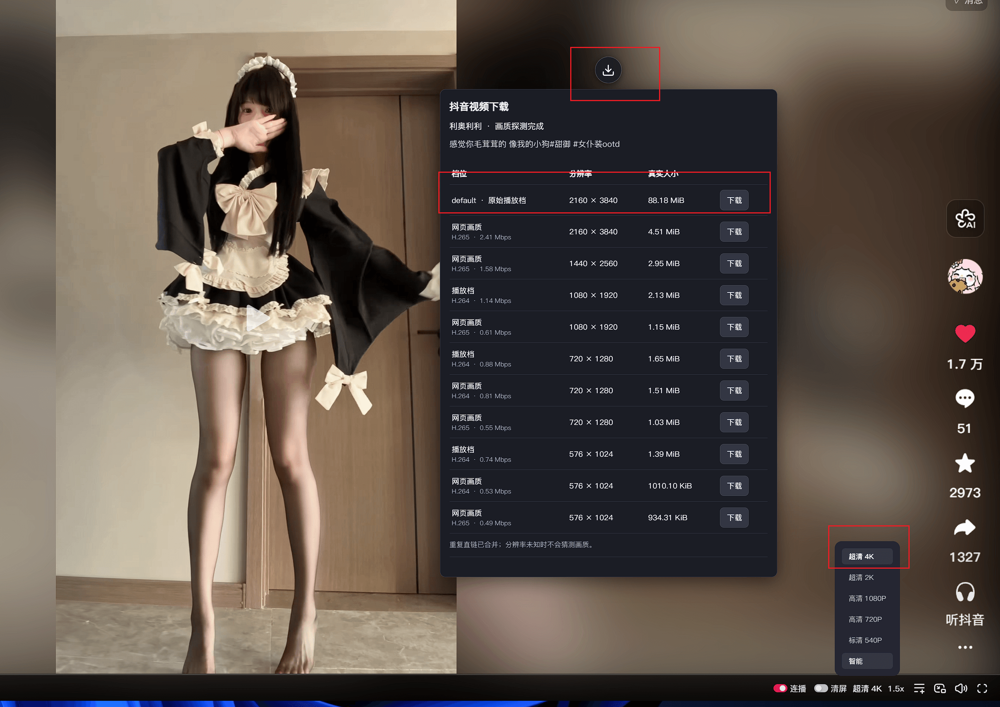
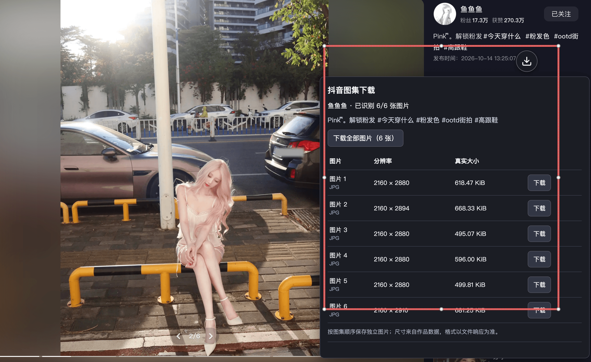

# 抖音画质探测与下载

  

在抖音网页版点击下载图标，自动识别**当前正在看的视频或图集**：视频可选择画质下载，图集可逐张或整组保存。

当前版本：**0.4.2**。适用于桌面 Chrome / Edge 与 Tampermonkey（油猴），无需 Python、独立浏览器或后台服务。

源码仓库：<https://github.com/like-ycy/douyin_download_userscript> —— 欢迎 Star；想修改或二次开发请直接打开该地址，问题反馈可提交 [Issue](https://github.com/like-ycy/douyin_download_userscript/issues)。

**视频下载示例**

**图集下载示例**

.png?locale=zh-CN)

## 功能

- 在推荐、关注和视频详情页识别当前作品，点击图标后才开始探测。
- 展示 `default` 播放档和网页提供的其他版本，读取实际文件大小，合并重复直链。
- 图集展示图片顺序、尺寸、格式和文件大小，支持单张下载或按顺序下载全部图片；优先使用页面提供的 JPEG 地址。
- 图集可一键打包为 ZIP 压缩包保存：包内文件名与逐张下载一致，下载与打包全程显示进度条，打包阶段显示动态条纹提示，随时可取消。
- 实况图可下载为 Apple Live Photo：每张生成具有配对元数据的同名 JPG + MOV，以 ZIP 保存；支持逐张、整组下载，也可单独保存静态图。转换在浏览器本地完成，视频不重新编码。
- 下载图标可拖动，刷新或重新打开页面后记住位置，窗口变小时保持在可见区域。
- 探测面板跟随下载图标弹出：图标在上半屏时向下展开、下半屏时向上展开，拖动图标时面板实时跟随；再次点击图标即可收起。
- 自动生成「作者 - 标题 - 画质.mp4」文件名，清理非法符号、控制字符与 Windows 保留名称。
- 图集文件名为「作者 - 标题 - 图片001.jpg」等，扩展名按实际图片格式生成，保留原图集顺序。
- 完整文件名最多 120 个 UTF-16 单元、200 个 UTF-8 字节，包含画质后缀及扩展名；截断时保留完整 emoji 和组合字符。
- 支持停止探测、取消下载；切换作品时取消旧探测，已开始的下载保持原作品。

## 安装

1. 在浏览器安装最新版 Tampermonkey，并在扩展管理页开启「允许运行用户脚本」。旧版浏览器可能需要开启扩展的「开发者模式」。建议使用 Tampermonkey **5.5 或更新版本**；旧版本可能不支持本脚本保存 ZIP 等文件所需的接口。
2. 点击浏览器工具栏的**油猴图标 → 管理面板 → 设置**，将「配置模式」设为**高级**，找到「下载」区域，将「下载模式」设为**原生（Native）**，然后点击**保存**。Windows Chrome 用户建议先完成这一步，避免下载文件名变成 UUID（一串随机字母和数字）。这是油猴全局设置，也会影响其他脚本的下载方式。
3. 打开 [Greasy Fork 发布页](https://greasyfork.org/zh-CN/scripts/600007-%E6%8A%96%E9%9F%B3%E7%94%BB%E8%B4%A8%E6%8E%A2%E6%B5%8B%E4%B8%8E%E4%B8%8B%E8%BD%BD)，点击「安装此脚本」，油猴会自动完成安装，后续更新也会自动检查。
4. 刷新 [抖音网页版](https://www.douyin.com/)，使用网页已有的登录状态。修改油猴设置或更新脚本后，也需要刷新已打开的抖音页面。

先下载一个视频或一张图片，在浏览器下载列表中确认文件名和保存位置，再尝试整组下载。面板会显示当前下载模式；如果下载功能被关闭，会显示设置步骤并禁用下载按钮。脚本不会自动修改油猴配置。

如果你原本使用「浏览器 API」且文件名正常，可以继续使用；它需要授予油猴下载权限。Windows Chrome 下切换「原生」可解决的 UUID 问题已有实际使用反馈，相关原因和其他排查方法见下方常见问题。

## 使用

播放视频后，点击画面旁的下载图标，自动识别并探测当前作品，面板在图标旁弹出（见上方视频下载示例）。从结果表格选择一行点击「下载」，再次点击图标可收起面板。按住图标拖动可调整位置，面板会跟着移动，松手自动保存。

查看图集时，点击同一个下载图标即可列出全部图片，无需翻动图片或进入详情页。可逐张下载、点击「下载全部图片」顺序保存为独立文件，或点击「下载为 ZIP」打包成一个压缩包（图片多时更省事）。部分图片探测失败时会显示原因，并可下载已识别的图片。图片尺寸来自作品数据，保存的是网页提供的图片版本，不保证是上传原文件。

实况图会显示「实况」和「下载实况」按钮，下载得到一个 ZIP，内含「实况001.jpg」和「实况001.mov」这类同名前缀的配对文件。「下载为 ZIP」会将每张实况图的两个文件一起打包；普通静态图仍为单个文件。「静态图」按钮只保存照片。实况图的分辨率显示动态视频尺寸，大小显示照片和视频源文件合计；网页静态照片和动态视频的分辨率可能不同。动态资源缺失时会明确标为「仅静态」，转换失败则报错，不会将静态图片伪装为实况照片。

**导入苹果相册：** 解压 ZIP，在 Mac「照片」中选择「文件 → 导入」，同时选中同名的 JPG 和 MOV。配对文件应作为一张 Live Photo 导入；然后通过 iCloud 照片同步到 iPhone，或从 Mac「照片」分享该实况照片到 iPhone，再长按播放。不要只导入 JPG，也不要将两个文件分别保存到 iPhone 相册。iPhone「文件」中直接解压后点「存储图像」不能完成配对导入，需要能导入 Live Photo 文件对的应用。

生成格式使用 JPEG MakerApple 标识、MOV content identifier 和 still-image-time 定时元数据。已使用 macOS PhotoKit 验证本次三图样本；iPhone 实机导入仍需按上述方式确认。这里只支持相册实况播放，不保证可用作 iPhone 动态锁屏壁纸。照片时间标记设在视频中点，网页未提供原始拍摄时间标记。

优先使用网页提供的 JPEG，保留其压缩图像内容；网页只有 PNG、WebP 等格式时，会在浏览器中将静态照片转为 JPEG，因此这部分静态图会重新编码。视频始终不重新编码。

整组下载可以取消，已保存的图片会保留；途中失败会停止后续下载并提示已完成或已提交数量，可单独重试剩余图片。ZIP 在所有内容读取并打包成功后才保存；如果中途失败，已读取的图片不会自动另存成独立文件。切换作品不会改变已经开始的下载队列。

首次请求媒体服务器时，如果油猴询问跨域权限，允许访问脚本声明的域名；图集新增使用 `douyinpic.com`。

如果提示文件类型不允许，在**油猴管理面板 → 设置 → 配置模式：高级 → 下载**中，将 `.mp4`、`.zip` 以及需要的图片扩展名（`.jpg`、`.png`、`.webp`、`.gif`、`.avif`）加入文件扩展名允许列表，保存后刷新抖音页面。实况照片的 `.mov` 位于 ZIP 内，下载实况时需要允许的是 `.zip`。

「浏览器 API」模式先通过油猴取回文件，再交给浏览器保存，因此需要内存暂存完整文件；图集一次处理一张，实况转换需同时暂存照片和对应短视频，整组 ZIP 需暂存全部文件。「原生」模式的完成提示表示已交给浏览器保存，请以浏览器下载列表为准；已经提交的文件需要在该列表中取消。打包时的转换和计算可能短暂占用页面，取消操作会在当前计算结束后处理。

下载目录由浏览器设置决定，可从下载列表选择「在文件夹中显示」。Windows 如果仍提示路径或文件名过长，可在浏览器设置中换用较短的下载目录；脚本的文件名限制不涵盖完整目录路径长度。下载、实况转换或打包期间，请保持抖音标签页打开，避免刷新页面、关闭浏览器或让电脑休眠。

## 画质与大小

| 显示 | 含义 |
| --- | --- |
| `default · 原始播放档` | 使用 `ratio=default` 播放接口，单独置顶；**就是该作品的最高画质**（原始上传播放档），追求画质直接选它即可。 |
| 播放档 | 移动端播放接口返回的文件。请求的 `4k` 可能返回较低画质，因此不会直接用请求参数当作实际分辨率。 |
| 网页画质 | 网页详情中的其他版本，可能包含不同码率和 H.264 / H.265 编码；H.265 需要播放器支持。 |
| 真实大小 | 从 CDN 的 `Content-Range` 等响应头读取，缺失时显示「大小未知」。 |

探测大小通常只读取一个字节；读取实际分辨率时最多额外读取两段各 256 KiB 的 MP4 索引。CDN 忽略 Range 请求时停止读取并报错。

## 常见问题

- **面板名称正常，保存后却变成 UUID**：例如 `45ad40f0-7603-46dd-9fff-3b1a956e0619.mp4`。这是油猴官方记录过的下载扩展冲突现象：其他扩展监听 Chrome 的文件命名事件时，可能覆盖油猴传入的名称，最终使用临时 Blob 地址中的 UUID。视频、单张图片和 ZIP 都可能受影响；仅更新本脚本或重新登录抖音不能保证解决。将油猴「下载模式」改为「原生（Native）」后刷新页面重试，或停用 IDM Integration Module、图片助手等下载相关扩展后重试。「原生」模式下请以浏览器下载列表确认保存结果；如果问题仍存在，反馈脚本、油猴和浏览器版本、实际文件名及下载相关扩展列表。参见 [Tampermonkey 官方说明 #2879](https://github.com/Tampermonkey/tampermonkey/issues/2879#issuecomment-5479471031)。
- **没有下载图标，或更新后没有变化**：确认油猴和本脚本均已启用，浏览器扩展详情中已允许油猴访问 `www.douyin.com` 并开启「允许运行用户脚本」，再刷新页面。已安装脚本版本应为 `0.4.2`；通过 Greasy Fork 安装时，可等待油猴自动更新或手动检查更新。如果安装了多个本脚本的副本，只保留一个启用。
- **下载按钮是灰色的**：先查看面板中的下载模式提示。下载功能被关闭时，按安装步骤开启；下载进行中也会暂时禁用其他下载按钮，图集的整组按钮需等探测结束后才能使用。
- **提示已提交，下载列表却没有文件，或整组只有第一张**：打开浏览器下载列表检查是否失败、被取消或正在等待选择保存位置，并留意地址栏附近的「自动下载多个文件」提示；仅在你正在下载图集时允许该站点连续下载，也可以改用「下载为 ZIP」。不要仅根据面板的「已提交」数量判断文件已保存。
- **进度停住、提示超时或保存失败**：先查看浏览器下载列表，避免重复下载已经保存的文件；仍在传输时可点击「取消下载」，再重新探测后重试。整组 ZIP 占用内存较多，图片多或实况文件较大时可以改为逐张下载。若提示缺少下载权限，按油猴提示授权；错误提示中的扩展名应在油猴设置的允许列表中开启。
- **首屏或某条作品没有识别出来**：脚本读取页面内嵌的 RSC 数据和后续网络响应；点击后最多等待 10 秒，其间也会读取当前卡片或视频上层容器的组件数据，识别正在看的作品。仍失败时刷新页面重试。
- **某些画质失败**：展开「查看未成功的探测」。CDN 可能拒绝部分版本，已成功的版本仍可以下载。
- **下载地址过期**：刷新页面并重新探测。移动端档位下载前会重新获取签名地址。
- **复制了分享短链接才可以下载吗**：不需要。在推荐、关注页直接点击图标即可，地址栏不变或播放器使用 `blob:` 也支持。
- **下载的视频有声音但黑屏，或播放器不支持**：网页提供的部分版本使用 H.265 编码。可换用支持该编码的播放器，或在面板中选择标有 H.264 的版本；修改文件扩展名不会改变编码。

反馈问题时，请附上脚本版本、Tampermonkey 版本、浏览器版本、操作系统、面板显示的下载模式、失败的是视频/单图/实况/ZIP，以及完整错误提示。文件名异常时再补充实际保存的名称和下载相关扩展列表。不需要提供 Cookie、登录信息或带签名的媒体下载地址。

当前支持普通视频、图片图集及网页提供了对应视频的实况图。实况转换支持非分片 MP4/MOV 中的 H.264/H.265 视频和 AAC 音频，其他编码或损坏文件会提示失败。直播、加密内容不在支持范围内；Safari、手机浏览器和其他脚本管理器尚未验证。抖音页面或接口变更后可能需要更新脚本。

- **不建议下载时长较长的视频**：本脚本主要用于自用，针对**一分钟内**的短视频设计；更长的视频尚未做过测试，可能无法正常下载或保存。

## 文件与发布

本仓库只包含独立用户脚本和文档，无需安装依赖或构建。登录由抖音页面完成，脚本不导出或保存登录 Cookie；油猴存储仅用于图标位置。
